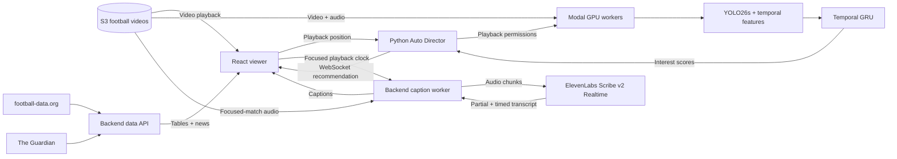

# Touchline

**One screen. Seven football matches. An AI director that decides what to watch.**

Touchline is a football-viewing web app that monitors multiple matches at once and recommends the match most worth watching. Instead of constantly checking seven streams yourself, you can leave **Auto Director** on—or choose any match manually.

Our hackathon demo replays seven prerecorded Premier League broadcasts. The video player, match predictions and live captions work together in real time during playback. Touchline also includes current league tables and football news.

> **Demo note:** These are prerecorded matches, not live broadcasts. Our prediction model is experimental. Model scores are relative rankings, **not** calibrated probabilities of a goal.

## What you can try

- **Watch seven matches:** One large player, six selectable previews, and playback that stays aligned when you switch.
- **Auto Director:** A trained model scores each match every two seconds and the backend decides when to switch. Choose **Relaxed**, **Balanced** or **All Action**, or turn it off and pick manually.
- **Live commentary captions:** ElevenLabs Scribe v2 Realtime transcribes the commentary of the **currently focused** match as it plays. Captions follow manual and automatic switches.
- **League tables and news:** Current standings from football-data.org and football headlines from The Guardian, with attribution and links to original articles.

No account is required.

## How it works



The frontend and ML workers access the video sources **independently**. The backend does not repeatedly upload five-second raw video clips to the GPU.

Each GPU worker samples video at **15 frames per second**, runs YOLO26s on each new sampled frame once, and caches the observations. Overlapping five-second windows reuse previous detections. The research feature extractor produces a **`(75, 215)` float32 tensor** containing player, ball, camera and audio information. The selected classifier applies its own feature transformation and outputs an interest score.

The backend compares scores for all available matches and sends switching instructions over WebSocket. Actual browser playback positions control the replay timeline, so the workers cannot intentionally analyse footage beyond the last permitted playback position.

## Our prediction model

| Detail | Implementation |
|---|---|
| Model | Lightweight, three-head temporal GRU; the app uses the **`shots3_10`** head |
| Parameters | **4,179** |
| Training data | **11 football matches** (22 halves) |
| Validation data | **4 separate matches** (8 halves) |
| Extracted data | **665,955 sampled timesteps** across training and validation, at 15 FPS |
| Observation | Previous **5 seconds** |
| Extracted input | **75 × 215** features; transformed by the released model into 68 input channels |
| Prediction cadence | Every **2 seconds** |
| Task | Rank matches based on evidence of shots/goals in the **3–10 seconds ahead** window |

We tested several feature representations and models before selecting this small temporal GRU. Its size makes scoring inexpensive relative to video processing.

### What the evaluation showed

The research replay measured what a viewer **actually had on screen**, rather than only whether an event was classified correctly. On four validation matches, using a **simulated one-second display delay**, the research-selected policy showed:

| Viewing metric | Result |
|---|---:|
| Shots shown | **66.3%** |
| Qualifying events shown | **60.1%** |
| Goals shown | **10 of 12** |

**These are not goal-prediction accuracy figures.** Some events were already on screen before a prediction, and these same validation matches informed model selection. The untouched test set has not been evaluated.

Our deployed director has user-friendly switching safeguards, so its results differ from the research policy. In a separate replay using the application's actual settings and a simulated **2.157 s prediction delay plus 0.25 s display delay**:

| Director mode | Events shown | Shots shown | Goals shown | Switching |
|---|---:|---:|---:|---|
| **Balanced** | 27/138 | 15/92 | 0/12 | Only 2 switches over ~89.75 min |
| **All Action** | 70/138 | 46/92 | 8/12 | ~2.45 switches/min |

Five of the eight goals shown by All Action followed a switch within ten seconds before the goal; three were already being watched earlier.

**Balanced is the calmer default, but this test suggests it is too reluctant to switch with the new model.** We have not tuned that trade-off away or claimed the research result transfers directly to the website.

## Measured system performance

In a bounded **seven-source, four-T4** test with the selected model:

| Measurement | Result |
|---|---:|
| Complete seven-match score cohorts | **13/13** |
| Observation-to-WebSocket latency | **1.734–2.109 s** |
| Median latency | **1.859 s** |
| Three-second deadline misses | **0** |

Six overlapping windows from two independent S3 sources also matched the reference feature extractor exactly, including corrected audio. A separate Edge browser test observed real model-driven switches and genuine ElevenLabs commentary captions.

These are **short, bounded tests**, not a claim of multi-hour uptime or frame-perfect video synchronisation.

## Run Touchline locally

You'll need **PowerShell**, **Node.js**, the application's Python environment, and the existing private Modal inference credentials if you want real ML monitoring. Run the commands from the project root.

### Terminal 1 — Backend

For a persistent local website with no automatic GPU start:

```powershell
cd "C:\Users\oshea\non-one-drive-stuff\hack-the-burgh-2026\hack-the-burgh-2026-project"

& backend/ml_inference/.venv-deploy/Scripts/python.exe -B -m backend.local
```

The site can play videos, show tables and news, and use configured commentary captions without turning on GPU monitoring. A controlling viewer can start the selected model by choosing **Auto On**.

To start a **bounded** real-model monitoring session automatically when playback connects, use this backend command instead:

```powershell
& backend/ml_inference/.venv-deploy/Scripts/python.exe -B -m backend.local --allow-cloud --seconds 2400 --budget 10
```

This authorises up to 40 minutes and a **$10 estimated inference allowance**. It is not a provider-enforced billing cap. Do not run two backend sessions at once.

### Terminal 2 — Frontend

```powershell
cd "C:\Users\oshea\non-one-drive-stuff\hack-the-burgh-2026\hack-the-burgh-2026-project"

$env:PORT = '3030'
$env:BROWSER = 'none'
$env:REACT_APP_WS_URL = 'ws://127.0.0.1:8030'
$env:REACT_APP_API_URL = 'http://127.0.0.1:8031'

npm --prefix frontend/sports-streaming-service start
```

Open **http://127.0.0.1:3030/**.

Keep both terminals open. Press `Ctrl+C` to stop them.

For a **provider-free UI check**, launch the backend with `--offline --no-captions`.

A finite two-minute seven-match demo is also available:

```powershell
& backend/ml_inference/.venv-deploy/Scripts/python.exe -B -m backend.demo --allow-cloud --matches 7 --seconds 120
```

Unlike `backend.local`, this demo command shuts down its backend when the timer ends.

### API keys (optional per feature)

Copy `.env.example` to a gitignored `.env` in the repository root, then configure the services you want:

```dotenv
FOOTBALL_DATA_API_KEY=
GUARDIAN_API_KEY=
ELEVENLABS_API_KEY=
```

- **football-data.org** supplies the current league tables.
- **The Guardian Open Platform** supplies real news metadata and source links.
- **ElevenLabs Scribe v2 Realtime** transcribes the selected match's actual commentary. A separately installed caption runtime is required; see `.env.example` and `backend/requirements-captions.txt`.

Keep credentials server-side. Never commit `.env`. Without a key, the relevant feature shows an explanatory unavailable state rather than invented data.

Live captions default to **On** with a valid key and active playback. Only the focused match is transcribed. Paid caption usage has its own configured duration and estimated budget limits, independent of Modal GPU monitoring.

## Project structure

| Area | Responsibility |
|---|---|
| `frontend/sports-streaming-service/` | React viewer, Auto Director controls, captions, tables and news |
| `backend/replay/` | Session management, source clocks and director decisions |
| `backend/ml_inference/` | Modal workers, incremental extraction, model loading and evaluation |
| `backend/captions/` | ElevenLabs realtime transcription |
| `backend/football_platform/` | League standings and football news APIs |
| `frontend/sports-streaming-service/src/data/matches.json` | Canonical seven-match source/fixture metadata |

The consumer-facing name is **Touchline**. Some internal names still start with `MATCHPULSE_` or `matchpulse-` so existing configuration and cloud resources continue to work.

## Current limitations

- **Recorded demo footage:** The seven football recordings are replayed, not live broadcasts. Any public redistribution requires appropriate media rights.
- **Experimental predictions:** Scores are uncalibrated; they are not goal probabilities. Model-selection results are not held-out test accuracy.
- **Switching trade-off:** Balanced mode changes matches infrequently in the current replay evaluation. All Action catches more events but makes more switches.
- **Short performance tests:** We have measured seven-source inference and real browser switching, but not certified long-running reliability or exact audiovisual synchronisation across every device.
- **Caption errors:** Automated football commentary transcription can mishear player names or speech over crowd noise, and carries some delay.
- **Usage costs:** Real GPU inference and ElevenLabs transcription use paid third-party resources. Local application budgets are estimates rather than hard billing limits.

## Built with

**React · Python · PyTorch · YOLO26s · Modal · AWS S3 · WebSockets · ElevenLabs Scribe v2 Realtime · football-data.org · The Guardian Open Platform**

---

*Touchline was built as a university hackathon project. Detailed benchmarks, deployment checks and research reports are retained separately for anyone who wants to inspect the methodology.*
